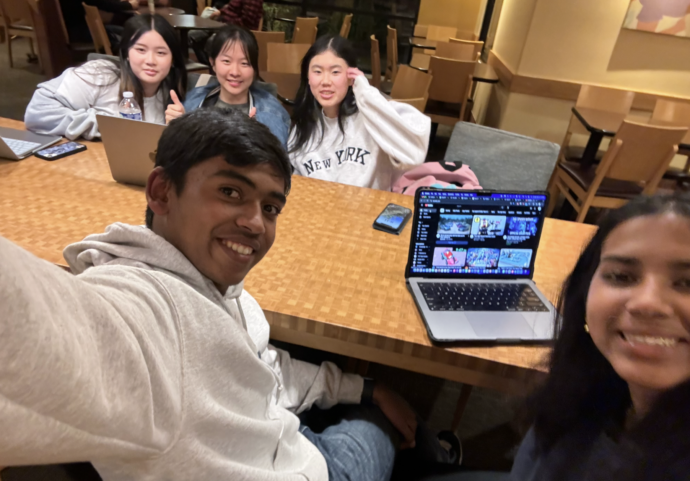
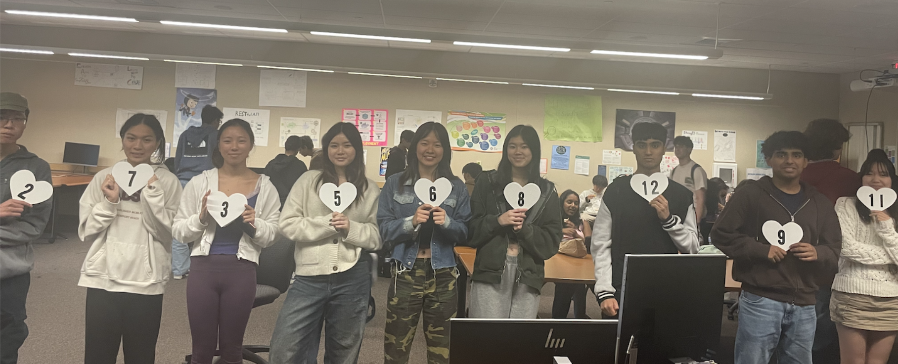
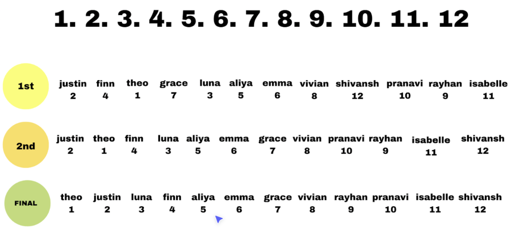

## Preparation
- Diversity: 7 girls 6 boys
- 3 full team practices (2 Panera meet up to write/finalize script, 1 Lunch Practice)

## Diagram

## Advertising/Publishing
- Email: codemaxxers@gmail.com
- YouTube: codemaxxers (post wednesday performance)
- Tiktok: codemaxxers7 (viral tiktok trends to advertise)

Links:
- [Theo Thirst Trap](https://www.tiktok.com/t/ZTLkLeKQd/)
- [Why Did This Dance Go Viral](https://www.tiktok.com/t/ZTLknNKYP/)

## Overview
- Performance: 4/3 8:30 AM Wednesday
- Explained what we are trying to show before start actual performance (Tanisha introduce bachelor idea)
- Artistic impression & algorithmic accuracy > 10/10/10/10/10, #1 Algorithmic Performance 

## Other Dances
- Merge (Flowers - good dancing aspect of flowers, could explain how merging back together works)
- Insertion (Apple Juice - funny)
- Selection (Beach - some confusion with sorting... but pulled it off, a bit confusing)
- Quick (Murder Mystery - very intersting story, well planned out. hard to see numbers)
