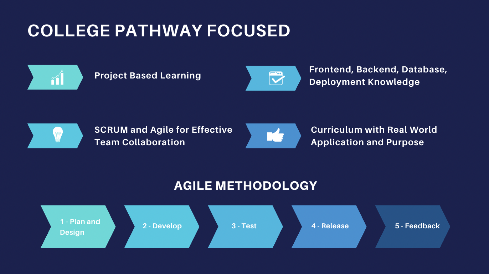
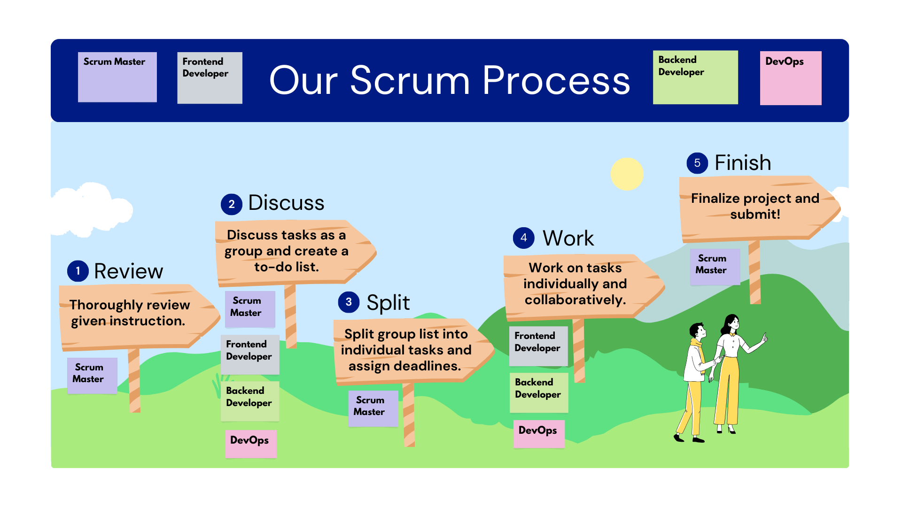
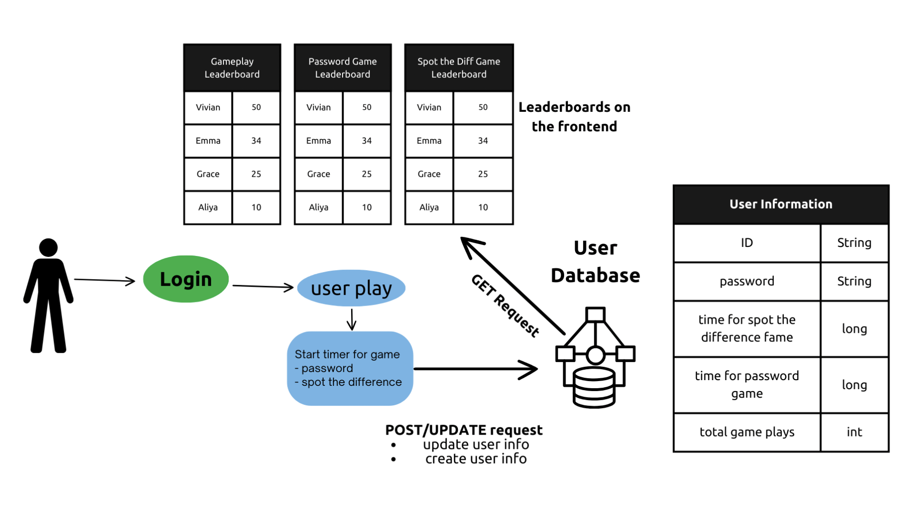
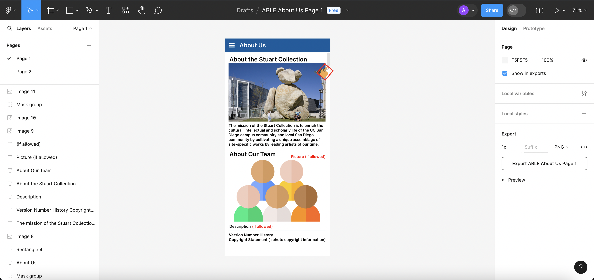

# Nighthawk Coders Content Creation Internship
Goals:
- Introduce new students to computer science and its applications
- Introduce collaboration skills that are necessary in college and career
- Shape the future of CompSci education in the Poway Unified School District

Key Requirements:
- Computer science qualifications and skills
- Content and course creation
- System development and data analysis

# Personal Qualifications
As a computer science student with a deep-rooted interest in data science, software development, and cybersecurity, I am excited about the oppurunity to participate and contribute to this internship. My AP CSP and AP CSA classes have been an integral part of not only but also my journey as a student. It has shaped my work ethic, team work, presentation skills, and more. Thus, I am passionate about making computer science accessible and engaging for new learners. 

I am confident in my ability to contribute efectively with my solid foundation in technical skills, extensive project experience, and a strong commitment to collaborative teamwork. I am excited to use technology to create innovative solutions.

Creating content and courses for the Poway USD Computer Science Pathway
- Skills: Graphic design, Canva, Figma

College Pathway Focused Diagram

Scrum Process Diagram

Full Stack Ideation Digaram

# Coding Qualifications
1. Content and Course Creation:
- Develop and create educational content and courses tailored to the PUSD Computer Science Pathway.
- Ensure that the content aligns with current educational standards and future trends in computer science education.

2. Student Pathway Tracking System 
- Develop a system to monitor students' progress through the computer science pathway. 
- The system should enable educators to identify what aspects of the curriculum are effective and which need revision.

3. Data Capture and Pathway Recommendation
- Collected data of student's progress, prerocess the data to ensure it is clean and suitable for training
- SQLite database to store student data. Tables should be designed to hold relevant information: interests, work habits, performance, course progress, etc.
- Implement RESTful APIs to handle CRUD opertions for student data

4. Personalized Learning Paths
- Recommend various STEM/AP classes
- Suggest projects, roles, programming languages, tools that support various learning styles: frontend development, backend development, DevOps, etc.
- Use of nerual networks (inspiried by human brain to handle complex tasks involving large datasets and intricate patterns)
- Collected data of students will be the training data for machine learning model, ALSO validate model's performance with a separate dataset or even real life data (relatively low risk task and can have human judgement along the way)
- Decision trees to categorize students based on performance and learning preferences

5. Student Pairing and Team Formation
- Perform data analysis on key indicators to recommend optimal student pairings and teams.
- Consider common interests, diverse perspectives, and invididual skills to create successful and complementary teams
- Collaborative filtering machine learning algorithm to make recommendations based on preferences an behaviors of similar students
- Content based filtering to make recommendations based on past courses and projects of user

6. Possibly Receive Feedback from Students
- Natural Language Processing (NLP) to analyze student feedback and identify places of improvement

7. Experience in Full Stack Development and Emerging Technologies:
- Provide candidates with hands-on experience in full stack development
- Explore technologies such as Machine Learning (ML) and Artificial Intelligence (AI)
- Integrate and experiment with emerging OpenAI technologies, including voice and personal assistant applications

### Theoretical Implementation Overview:
- Gather and ensure data is clean (step 3)
- Neural network architectures (Convolutional Neural Networks for images like handwriting or diagrams, Recurrent Neural Networks for progress over time and patterns, Feedforward Nueral Networks to predict student sucess) implemented with TensorFlow
- Note: TensorFlow is easy to use as the KerasAPI simiplifies nerual network creation and training, flexible library with support for various network architechture
- Train and validate data, evaluate and adjust as needed (step 4)
- Deployment and integration of trained model into education platform, ensure it can handle real-time data and feedback
- Monitoring and updates of performance

## Links and Demonstrations of Projects
- [Project - Rift Cyber Game Site](https://www.loom.com/share/f5aa32ae51044fd58e5323cd1a7b1255)
- [Project - Sorting Art Gallery Site](https://www.loom.com/share/f5aa32ae51044fd58e5323cd1a7b1255)
- [Project - UCSD Stuart Collection App](https://www.loom.com/share/6e468c902be848898f96bf8f695f963f)
- [Project - Cafegato Promotional Site](https://www.loom.com/share/aa3a353263f9448ea979b20049f824eb)
- [Presentation - Pneumonia Detection](https://docs.google.com/presentation/d/1AK04e1cO27SjEg7b9RZWmagIe_ciKjMPGfrnxFjA1KU/edit?usp=sharing)
- [Project pt.1 - Pneumonia Detection](https://colab.research.google.com/drive/15aMkk4Ej8oaBO0AtkBuuKY5SHbcfEbut?usp=sharing)
- [Project pt.2 - Pneumonia Detection](https://colab.research.google.com/drive/1hYFSEYNPzwbEbbu4mRzNvn6y3G5SVglJ?usp=sharing)

These projects and others have been demonstrated in various showcase events:
- Night at the Museum May 2024
- Night at the Museum Feb 2024
- Night at the Museum Oct 2023
- Night at the Museum May 2023
- Night at the Museum Feb 2023
- Night at the Museum Oct 2022